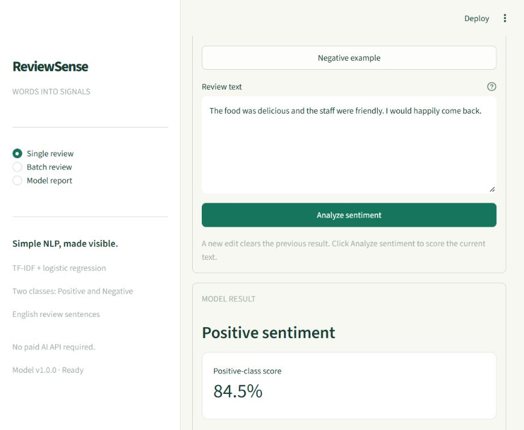

# ReviewSense

A simple English review sentiment application. Analyse one review or upload a CSV, inspect the positive/negative summary, and download the scored results.

ReviewSense uses **TF-IDF and logistic regression** rather than a paid AI service. A Streamlit interface exposes the trained model and its recorded evaluation.



## Features

- Single-review sentiment analysis with a positive-class model score.
- CSV analysis for up to 1,000 reviews / 1,000,000 bytes.
- Downloadable scored CSV with spreadsheet formula protection.
- One shared cleaning and validation path for individual and batch reviews.
- Model comparison, held-out metrics, per-domain results, and examples of errors.
- An explicit **Not scored** result when the review has no features in the learned vocabulary. This is not a neutral-sentiment class.

## Run locally

Use Python 3.12. From the project directory in PowerShell:

```powershell
python -m venv .venv
.\.venv\Scripts\python.exe -m pip install -r requirements.lock.txt
.\.venv\Scripts\python.exe scripts/download_data.py
.\.venv\Scripts\python.exe -m reviewsense.train
.\.venv\Scripts\python.exe -m streamlit run app.py --server.address 127.0.0.1 --server.port 8501
```

Open [ReviewSense](http://127.0.0.1:8501). On macOS/Linux, substitute `.venv/bin/python` for the Windows interpreter path. Installation and dataset download need internet access; inference uses the locally trained artifact. No AI API key is needed.

After setup, start the application using the final command or `Start-ReviewSense.ps1`. Stop it with Ctrl+C. Missing or inconsistent model artifacts must be regenerated before scoring. Only load artifacts from trusted training runs.

## Try it

1. Open the single-review page and submit a short English review.
2. Read the model score as an estimate from this model, not a calibrated guarantee.
3. Download the example CSV from the batch page, upload it, and analyse the reviews.
4. Inspect the summary and download the scored CSV.
5. Open the model-report page to see benchmark results and examples the model misclassifies.

The example CSV contains demonstration text, not newly collected customer feedback or a held-out evaluation set.

## CSV contract

Use a UTF-8 CSV with the required column `review` and optional column `review_id`. Other columns are rejected. Headers must be unique. Supplied IDs must be unique and no longer than 80 characters; otherwise row identifiers are generated.

```csv
review_id,review
R1,"The staff were helpful and the food was excellent."
R2,"The product stopped working and support was disappointing."
```

Each review must contain alphabetic text and be at most 10,000 characters. Entire batches are rejected if any row is invalid, so a summary never silently omits a malformed input. A text that passes validation can still be outside the model vocabulary; such rows are returned as Not scored and excluded from sentiment totals.

## Dataset and experiment

The source is the [UCI Sentiment Labelled Sentences dataset](https://archive.ics.uci.edu/dataset/331/sentiment+labelled+sentences), attributed to Dimitrios Kotzias (2015), DOI [10.24432/C57604](https://doi.org/10.24432/C57604), under [CC BY 4.0](https://creativecommons.org/licenses/by/4.0/). It provides 3,000 labelled sentences from product, restaurant, and movie reviews. It is a curated binary benchmark rather than a representative live review stream.

The pipeline normalizes Unicode, case, and whitespace. Exact normalized duplicates are removed before splitting; all examples in groups with conflicting labels are removed. The training and test partitions are separated by normalized review identity and stratified by source and label. TF-IDF is fitted inside each training CV fold, preventing held-out vocabulary and IDF statistics from entering fitting.

A prior-only baseline and logistic regression configurations are compared using three-fold training cross-validation. The best mean positive-class F1 selects the final model. Evaluation uses the held-out test partition with a fixed 0.5 decision threshold. The final model is fitted only on training data.

The recorded run removes 2 structurally invalid records and 20 duplicate records, leaving **2,978 reviews**: 2,382 training and 596 test reviews. No conflicting-label groups were found. Logistic regression with **C=4** has the highest mean training-CV positive F1 (0.808).

| Held-out metric | Result |
| --- | ---: |
| Accuracy | 81.2% |
| Positive-class precision | 80.4% |
| Positive-class recall | 82.6% |
| Positive-class F1 | 0.815 |
| Macro F1 | 0.812 |
| ROC-AUC | 0.896 |

These metrics evaluate the underlying classifier at threshold 0.5 on **all 596 test rows**. One test row has no learned vocabulary match; the application declines scoring such a row, while the classifier benchmark still includes it. The application-level abstention policy and the classifier metrics therefore have different scopes.

The prior baseline's training-CV positive F1 is zero because its learned positive prior is slightly below 0.5, so it predicts Negative for every review. This is a consequence of the metric and decision rule, not evidence that the baseline has zero accuracy.

Exact counts, candidate scores, test results, and error examples are recorded in `artifacts/report.json`. The model-report page reads those saved results. `artifacts/splits.json` records content-based review identities assigned to each partition.

## Model limitations

The model has two sentiment classes. It is not trained to identify neutral reviews, understand sarcasm reliably, classify emotions, or detect review authenticity. Word overlap is not evidence that a new review is in distribution. Model probabilities are not explicitly calibrated, and the interface must not present them as guaranteed confidence.

Exact deduplication reduces one leakage path; near duplicates, shared authors, and review timing are not fully controlled. The benchmark is balanced and deliberately excludes neutral examples, so its accuracy does not establish performance on real incoming feedback. Domain-level test results are descriptive and may have small sample sizes. Do not claim business impact, production scale, or improved customer satisfaction without measuring them.

See [the model card](docs/MODEL_CARD.md) for evaluation details and [the learning guide](docs/LEARNING_GUIDE.md) for a walkthrough of the implementation.

## Tests

After download and training:

```powershell
.\.venv\Scripts\python.exe -m pytest -q
```

The current suite passes 38 cases, including normalization, malformed inputs and CSVs, upload limits, inference parity, unsupported vocabulary, safe export, artifact consistency, split boundaries, training-only vocabulary/IDF, report integrity, and interactive Streamlit page checks. Browser checks additionally verified single-review scoring and a six-row CSV upload, summary, and downloadable export. The export was compared with direct saved-model predictions.

## Structure

```text
app.py                  Streamlit application
reviewsense/
  text.py               Shared text cleaning and validation
  io.py                 CSV validation and safe export
  train.py              Data preparation, training and evaluation
  service.py            Trusted artifact loading and inference
scripts/download_data.py
data/                   Dataset provenance and prepared reviews
artifacts/              Pipeline, report and split identities
tests/                  Behavioural and consistency checks
docs/                   Model card and learning guide
```

## Local operating boundary

This is a local application with no authentication, user database, or operational review-history storage. Review uploads are processed for the current session; they are not a training-data collection service. A hosted version needs its own access controls, retention policy, request limits, and monitoring. A model checksum checks consistency with a report; it is not an authenticity signature for arbitrary joblib files.
